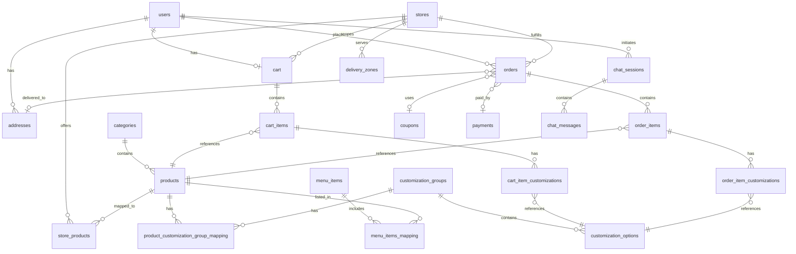

# Database Schema

PostgreSQL stores all application state. Drizzle ORM defines the schema in `backend/src/db/schema.ts` as a single centralized file. Migrations are generated and applied using `drizzle-kit`.

## Connection policy

- The database URL is constructed from individual environment variables (`DB_USER`, `DB_PASSWORD`, `DB_HOST`, `DB_PORT`, `DB_NAME`).
- A single connection pool is initialized at startup via `drizzle-orm/node-postgres`.
- All timestamps use `timestamp with time zone` and default to `now()`.
- Every table includes auto-incrementing `id` (generated always as identity), `created_at`, and `updated_at` columns (except junction tables and `chat_messages`).

## Schema conventions

The schema uses these reusable column definitions applied to every table:

```typescript
const id = integer().primaryKey().generatedAlwaysAsIdentity();
const createdAt = timestamp("created_at", { withTimezone: true }).defaultNow().notNull();
const updatedAt = timestamp("updated_at", { withTimezone: true }).defaultNow().notNull().$onUpdateFn(() => new Date());
const isActive = boolean("is_active").notNull().default(true);
```

All typed enums (`Role`, `OrderStatus`, `PaymentStatus`, etc.) are defined in `src/utils/types.ts` and applied to text columns via Drizzle's `.$type<T>()` helper. They are not database-level enums.

## Tables

### `users`

| Column | Type | Constraints | Notes |
| --- | --- | --- | --- |
| `id` | integer | PK, generated always | |
| `fname` | text | NOT NULL | First name |
| `lname` | text | NOT NULL | Last name |
| `password` | text | NOT NULL | bcrypt hash |
| `email` | text | UNIQUE, NOT NULL | |
| `role` | text | NOT NULL, default `"user"` | `"user"` or `"admin"` |
| `is_active` | boolean | NOT NULL, default `true` | |
| `created_at` | timestamptz | NOT NULL, default `now()` | |
| `updated_at` | timestamptz | NOT NULL, default `now()` | Auto-updates |

Relations: one-to-many with addresses, carts, cart items, orders.

### `addresses`

| Column | Type | Constraints | Notes |
| --- | --- | --- | --- |
| `id` | integer | PK | |
| `user_id` | integer | FK → users, NOT NULL | |
| `type` | text | NOT NULL | `"Home"`, `"Work"`, or `"Other"` |
| `street` | text | NOT NULL | |
| `city` | text | NOT NULL | |
| `state` | text | NOT NULL | |
| `pincode` | text | NOT NULL | |
| `phone` | text | NOT NULL | |
| `created_at`, `updated_at` | timestamptz | | |

### `categories`

| Column | Type | Constraints | Notes |
| --- | --- | --- | --- |
| `id` | integer | PK | |
| `name` | text | UNIQUE, NOT NULL | |
| `featured` | boolean | default `false` | |
| `is_active` | boolean | NOT NULL, default `true` | |
| `created_at`, `updated_at` | timestamptz | | |

Relations: one-to-many with products.

### `products`

| Column | Type | Constraints | Notes |
| --- | --- | --- | --- |
| `id` | integer | PK | |
| `name` | text | NOT NULL | |
| `description` | text | nullable | |
| `slug` | text | UNIQUE, NOT NULL | URL-safe identifier |
| `veg` | boolean | default `false` | |
| `has_customization` | boolean | NOT NULL, default `false` | Determines if customization UI is shown |
| `price` | real | NOT NULL | Base price before customizations |
| `image` | text | NOT NULL | Path relative to uploads dir |
| `is_available` | boolean | NOT NULL, default `true` | |
| `category_id` | integer | FK → categories, NOT NULL | |
| `created_at`, `updated_at` | timestamptz | | |

Relations: belongs to category; many-to-many with customization groups (via mapping), menu items (via mapping); one-to-many with cart items, order items.

### `stores`

| Column | Type | Constraints | Notes |
| --- | --- | --- | --- |
| `id` | integer | PK, generated always | |
| `name` | text | NOT NULL | Display name |
| `slug` | text | UNIQUE, NOT NULL | URL-safe identifier |
| `address`, `city`, `state`, `pincode` | text | NOT NULL | Physical location |
| `phone` | text | NOT NULL | Store contact number |
| `email` | text | nullable | Store contact email |
| `latitude`, `longitude` | double precision | nullable | Reserved for distance-based resolution |
| `opens_at`, `closes_at` | text | NOT NULL | Local operating times in `HH:mm` format |
| `is_active` | boolean | NOT NULL, default `true` | |
| `created_at`, `updated_at` | timestamptz | | |

Relations: one-to-many with store products, delivery zones, carts, and orders.

### `store_products`

| Column | Type | Constraints | Notes |
| --- | --- | --- | --- |
| `id` | integer | PK, generated always | |
| `store_id` | integer | FK → stores, NOT NULL | |
| `product_id` | integer | FK → products, NOT NULL | |
| `price` | real | NOT NULL | Store-specific product price |
| `is_available` | boolean | NOT NULL, default `true` | Store-level availability |
| `created_at`, `updated_at` | timestamptz | | |

Unique constraint: `(store_id, product_id)`.

### `customization_groups`

| Column | Type | Constraints | Notes |
| --- | --- | --- | --- |
| `id` | integer | PK | |
| `name` | text | NOT NULL | e.g., "Size", "Toppings" |
| `type` | text | NOT NULL | `"single"` or `"multiple"` |
| `required` | boolean | NOT NULL, default `false` | User must select an option |
| `created_at`, `updated_at` | timestamptz | | |

Relations: one-to-many with options; many-to-many with products (via mapping).

### `customization_options`

| Column | Type | Constraints | Notes |
| --- | --- | --- | --- |
| `id` | integer | PK | |
| `group_id` | integer | FK → customization_groups, NOT NULL | |
| `name` | text | NOT NULL | e.g., "Large", "Extra Cheese" |
| `price` | real | default `0` | Additional cost |
| `is_available` | boolean | NOT NULL, default `true` | |
| `created_at`, `updated_at` | timestamptz | | |

### `product_customization_group_mapping`

Junction table linking products to customization groups.

| Column | Type | Constraints |
| --- | --- | --- |
| `product_id` | integer | FK → products, NOT NULL |
| `group_id` | integer | FK → customization_groups, NOT NULL |

### `menu_items`

| Column | Type | Constraints | Notes |
| --- | --- | --- | --- |
| `id` | integer | PK | |
| `name` | text | NOT NULL | |
| `position` | integer | UNIQUE, NOT NULL | Display order |
| `image` | text | NOT NULL | |
| `slug` | text | UNIQUE, NOT NULL | |
| `is_active` | boolean | NOT NULL, default `true` | |
| `created_at`, `updated_at` | timestamptz | | |

### `menu_items_mapping`

Junction table linking menu items to products.

| Column | Type | Constraints |
| --- | --- | --- |
| `menu_item_id` | integer | FK → menu_items, NOT NULL |
| `product_id` | integer | FK → products, NOT NULL |

### `cart`

| Column | Type | Constraints | Notes |
| --- | --- | --- | --- |
| `id` | integer | PK | |
| `user_id` | integer | FK → users, NOT NULL | |
| `total_price` | double precision | NOT NULL, default `0` | Denormalized running total |
| `store_id` | integer | FK → stores, nullable | Cart may exist before store resolution |
| `created_at`, `updated_at` | timestamptz | | |

Relations: one-to-many with cart items.

### `cart_items`

| Column | Type | Constraints | Notes |
| --- | --- | --- | --- |
| `id` | integer | PK | |
| `cart_id` | integer | FK → cart (CASCADE DELETE), NOT NULL | |
| `product_id` | integer | FK → products, NOT NULL | |
| `quantity` | integer | NOT NULL, default `1` | |
| `price` | double precision | NOT NULL, default `0` | Snapshot of product price at time of add |
| `created_at`, `updated_at` | timestamptz | | |

Relations: one-to-many with cart item customizations.

### `cart_item_customizations`

| Column | Type | Constraints | Notes |
| --- | --- | --- | --- |
| `id` | integer | PK | |
| `cart_item_id` | integer | FK → cart_items (CASCADE DELETE), NOT NULL | |
| `customization_option_id` | integer | FK → customization_options, NOT NULL | |
| `price` | double precision | NOT NULL | Snapshot of option price |
| `created_at`, `updated_at` | timestamptz | | |

### `coupons`

| Column | Type | Constraints | Notes |
| --- | --- | --- | --- |
| `id` | integer | PK | |
| `code` | text | UNIQUE, NOT NULL | Case-sensitive coupon code |
| `discount_type` | text | NOT NULL | `"percentage"` or `"fixed"` |
| `discount_value` | double precision | NOT NULL | Percentage or absolute amount |
| `min_order_value` | double precision | NOT NULL | Minimum order total to apply |
| `start_date` | timestamptz | NOT NULL | |
| `end_date` | timestamptz | NOT NULL | |
| `is_active` | boolean | NOT NULL, default `true` | |
| `redemption_count` | integer | NOT NULL, default `0` | Current uses |
| `max_redemptions` | integer | NOT NULL, default `-1` | `-1` = unlimited |
| `created_at`, `updated_at` | timestamptz | | |

### `payments`

| Column | Type | Constraints | Notes |
| --- | --- | --- | --- |
| `id` | integer | PK | |
| `status` | text | NOT NULL, default `"pending"` | `"pending"`, `"processing"`, `"completed"`, `"failed"` |
| `payment_date` | timestamptz | NOT NULL, default `now()` | |
| `created_at`, `updated_at` | timestamptz | | |

### `orders`

| Column | Type | Constraints | Notes |
| --- | --- | --- | --- |
| `id` | integer | PK | |
| `user_id` | integer | FK → users, NOT NULL | |
| `order_date` | timestamptz | default `now()` | |
| `discount_amount` | double precision | NOT NULL | Computed discount at checkout |
| `coupon_id` | integer | FK → coupons, nullable | |
| `total_price` | double precision | NOT NULL, default `0` | Final price after discount |
| `status` | text | NOT NULL, default `"pending"` | `"pending"`, `"preparing"`, `"delievered"`, `"cancelled"` |
| `payment_type` | text | NOT NULL, default `"cash"` | `"cash"` only (COD) |
| `payment_id` | integer | FK → payments, nullable | |
| `address_id` | integer | FK → addresses, nullable | |
| `store_id` | integer | FK → stores, NOT NULL | Fulfilling store |
| `created_at`, `updated_at` | timestamptz | | |

Relations: belongs to user, payment, coupon, address; one-to-many with order items.

### `order_items`

| Column | Type | Constraints | Notes |
| --- | --- | --- | --- |
| `id` | integer | PK | |
| `order_id` | integer | FK → orders, NOT NULL | |
| `product_id` | integer | FK → products, NOT NULL | |
| `quantity` | integer | NOT NULL, default `1` | |
| `price` | double precision | NOT NULL, default `0` | Price snapshot |
| `created_at`, `updated_at` | timestamptz | | |

Relations: one-to-many with order item customizations.

### `order_item_customizations`

| Column | Type | Constraints | Notes |
| --- | --- | --- | --- |
| `id` | integer | PK | |
| `order_item_id` | integer | FK → order_items, NOT NULL | |
| `customization_option_id` | integer | FK → customization_options, NOT NULL | |
| `price` | double precision | NOT NULL | Price snapshot |
| `created_at`, `updated_at` | timestamptz | | |

### `delivery_zones`

| Column | Type | Constraints |
| --- | --- | --- |
| `id` | integer | PK |
| `store_id` | integer | FK → stores, NOT NULL |
| `pincode` | text | NOT NULL |
| `created_at`, `updated_at` | timestamptz | |

Unique constraint: `(store_id, pincode)`.

### `delivery_price`

| Column | Type | Constraints | Notes |
| --- | --- | --- | --- |
| `id` | integer | PK | |
| `delivery_charge` | double precision | NOT NULL | |
| `min_order` | double precision | NOT NULL, default `0` | Minimum order for free delivery |
| `created_at`, `updated_at` | timestamptz | | |

### `chat_sessions`

| Column | Type | Constraints | Notes |
| --- | --- | --- | --- |
| `id` | integer | PK | |
| `user_id` | integer | FK → users, NOT NULL | |
| `subject` | text | nullable | |
| `status` | text | NOT NULL, default `"open"` | `"open"`, `"close"`, `"rejected"`, `"pending"` |
| `created_at`, `updated_at` | timestamptz | | |

Relations: one-to-many with chat messages.

### `chat_messages`

| Column | Type | Constraints | Notes |
| --- | --- | --- | --- |
| `id` | integer | PK | |
| `session_id` | integer | FK → chat_sessions, NOT NULL | |
| `sender_id` | integer | FK → users, NOT NULL | |
| `message` | text | NOT NULL | |
| `created_at` | timestamptz | NOT NULL | No `updated_at` — messages are immutable |

## Entity relationship diagram



## Transaction boundaries

The following operations use database transactions:

- **Cart add**: Creating/finding cart → creating cart item → creating cart item customizations → updating cart total price.
- **Cart update (quantity)**: Looking up current product price → updating cart item quantity/price → updating cart total.
- **Cart item delete**: Calculating price to subtract → deleting cart item → updating cart total.
- **Order creation**: Copying cart items to order items → copying customizations → clearing cart items → resetting cart total → creating the order record.

No transaction is held open while awaiting user input or external service calls.

## Known schema notes

- The `status` enum in orders includes `"delievered"` (typo). Existing data uses this spelling.
- `payment_type` is constrained to `"cash"` only (COD).
- `max_redemptions` of `-1` on coupons indicates unlimited redemptions.
- Cart and order items snapshot prices at creation time to protect against subsequent price changes.
- `cart_items` and `cart_item_customizations` cascade on delete of their parent.
