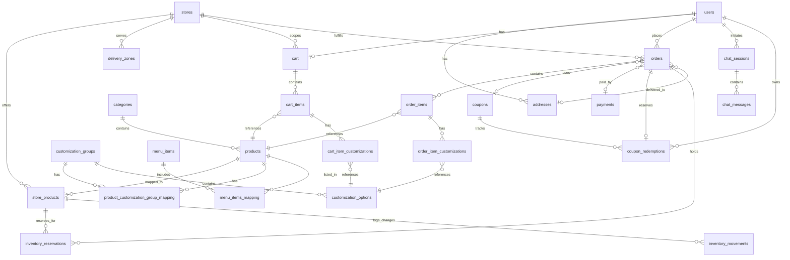

# Database Schema

PostgreSQL stores all application state. Drizzle ORM defines domain schemas in `backend/src/db/schema/`, with centralized relations in `_relations.ts`. Migrations are generated and applied using `drizzle-kit`.

## Connection policy

- The database URL is constructed from individual environment variables (`DB_USER`, `DB_PASSWORD`, `DB_HOST`, `DB_PORT`, `DB_NAME`).
- A single connection pool is initialized at startup via `drizzle-orm/node-postgres`.
- All timestamps use `timestamp with time zone` and default to `now()`.
- Every table includes auto-incrementing `id` (generated always as identity), `created_at`, and `updated_at` columns (except junction tables and `chat_messages`).

## Schema conventions

The schema uses these reusable column definitions applied to every table:

```typescript
const id = integer().primaryKey().generatedAlwaysAsIdentity();
const createdAt = timestamp("created_at", { withTimezone: true }).defaultNow().notNull();
const updatedAt = timestamp("updated_at", { withTimezone: true }).defaultNow().notNull().$onUpdateFn(() => new Date());
const isActive = boolean("is_active").notNull().default(true);
```

All typed enums (`Role`, `OrderStatus`, `PaymentStatus`, etc.) are defined in `src/utils/types.ts` and applied to text columns via Drizzle's `.$type<T>()` helper. They are not database-level enums.

## Tables

### `users`

| Column | Type | Constraints | Notes |
| --- | --- | --- | --- |
| `id` | integer | PK, generated always | |
| `fname` | text | NOT NULL | First name |
| `lname` | text | NOT NULL | Last name |
| `password` | text | NOT NULL | bcrypt hash |
| `email` | text | UNIQUE, NOT NULL | |
| `role` | text | NOT NULL, default `"user"` | `"user"` or `"admin"` |
| `is_active` | boolean | NOT NULL, default `true` | |
| `created_at` | timestamptz | NOT NULL, default `now()` | |
| `updated_at` | timestamptz | NOT NULL, default `now()` | Auto-updates |

Relations: one-to-many with addresses, carts, cart items, orders.

### `addresses`

| Column | Type | Constraints | Notes |
| --- | --- | --- | --- |
| `id` | integer | PK | |
| `user_id` | integer | FK → users, NOT NULL | |
| `type` | text | NOT NULL | `"Home"`, `"Work"`, or `"Other"` |
| `street` | text | NOT NULL | |
| `city` | text | NOT NULL | |
| `state` | text | NOT NULL | |
| `pincode` | text | NOT NULL | |
| `phone` | text | NOT NULL | |
| `created_at`, `updated_at` | timestamptz | | |

### `categories`

| Column | Type | Constraints | Notes |
| --- | --- | --- | --- |
| `id` | integer | PK | |
| `name` | text | UNIQUE, NOT NULL | |
| `featured` | boolean | default `false` | |
| `is_active` | boolean | NOT NULL, default `true` | |
| `created_at`, `updated_at` | timestamptz | | |

Relations: one-to-many with products.

### `products`

| Column | Type | Constraints | Notes |
| --- | --- | --- | --- |
| `id` | integer | PK | |
| `name` | text | NOT NULL | |
| `description` | text | nullable | |
| `slug` | text | UNIQUE, NOT NULL | URL-safe identifier |
| `veg` | boolean | default `false` | |
| `has_customization` | boolean | NOT NULL, default `false` | Determines if customization UI is shown |
| `price` | real | NOT NULL | Base price before customizations |
| `image` | text | NOT NULL | Path relative to uploads dir |
| `is_available` | boolean | NOT NULL, default `true` | |
| `category_id` | integer | FK → categories, NOT NULL | |
| `created_at`, `updated_at` | timestamptz | | |

Relations: belongs to category; many-to-many with customization groups (via mapping), menu items (via mapping); one-to-many with cart items, order items.

### `stores`

| Column | Type | Constraints | Notes |
| --- | --- | --- | --- |
| `id` | integer | PK, generated always | |
| `name` | text | NOT NULL | Display name |
| `slug` | text | UNIQUE, NOT NULL | URL-safe identifier |
| `address`, `city`, `state`, `pincode` | text | NOT NULL | Physical location |
| `phone` | text | NOT NULL | Store contact number |
| `email` | text | nullable | Store contact email |
| `latitude`, `longitude` | double precision | nullable | Reserved for distance-based resolution |
| `opens_at`, `closes_at` | text | NOT NULL | Local operating times in `HH:mm` format |
| `timezone` | text | NOT NULL, default `Asia/Kolkata` | Validated IANA timezone used to derive business dates |
| `is_active` | boolean | NOT NULL, default `true` | |
| `created_at`, `updated_at` | timestamptz | | |

Relations: one-to-many with store products, delivery zones, delivery pricing rules, carts, and orders.

### `store_products`

| Column | Type | Constraints | Notes |
| --- | --- | --- | --- |
| `id` | integer | PK, generated always | |
| `store_id` | integer | FK → stores, NOT NULL | |
| `product_id` | integer | FK → products, NOT NULL | |
| `price` | real | NOT NULL | Store-specific product price |
| `is_available` | boolean | NOT NULL, default `true` | Store-level manual availability |
| `on_hand_quantity` | integer | nullable, CHECK >= 0 | Physical stock count; `NULL` = untracked stock |
| `low_stock_threshold` | integer | NOT NULL, default `5`, CHECK >= 0 | Threshold for low stock status and alerts |
| `last_restocked_at` | timestamptz | nullable | Timestamp of last restock operation |
| `created_at`, `updated_at` | timestamptz | | |

Unique constraint: `(store_id, product_id)`.
Relations: belongs to store and product; one-to-many with inventory reservations and inventory movements.

### `inventory_reservations`

Tracks temporary stock reservations for in-flight online (Razorpay) checkout attempts to prevent overselling.

| Column | Type | Constraints | Notes |
| --- | --- | --- | --- |
| `id` | integer | PK, generated always | |
| `order_id` | integer | FK → orders, NOT NULL | Order reserving the stock |
| `store_product_id` | integer | FK → store_products, NOT NULL | Store product being reserved |
| `quantity` | integer | NOT NULL, CHECK > 0 | Number of units reserved |
| `status` | text | NOT NULL, default `"reserved"`, CHECK | `"reserved"`, `"consumed"`, or `"released"` |
| `expires_at` | timestamptz | NOT NULL | Reservation expiry deadline (default 30 mins) |
| `reserved_at` | timestamptz | NOT NULL, default `now()` | Creation timestamp |
| `consumed_at` | timestamptz | nullable | Set when payment succeeds and stock is deducted |
| `released_at` | timestamptz | nullable | Set when payment fails/expires or order is cancelled |
| `created_at`, `updated_at` | timestamptz | | |

Unique constraint: `(order_id, store_product_id)`.
Indexes: `(store_product_id, status)` for fast active-reservation lookups; `(status, expires_at)` for background expiry sweeps.

### `inventory_movements`

Append-only audit ledger of every inventory quantity transition.

| Column | Type | Constraints | Notes |
| --- | --- | --- | --- |
| `id` | integer | PK, generated always | |
| `store_product_id` | integer | FK → store_products, NOT NULL | |
| `change_type` | text | NOT NULL, CHECK | `"restock"`, `"sale"`, `"adjustment"`, or `"cancellation"` |
| `quantity_change` | integer | NOT NULL | Signed delta (`+` for additions, `-` for deductions) |
| `previous_quantity` | integer | NOT NULL, CHECK >= 0 | On-hand quantity before change |
| `new_quantity` | integer | NOT NULL, CHECK >= 0 | On-hand quantity after change |
| `reason` | text | nullable | Mandatory for manual adjustments |
| `order_id` | integer | FK → orders, nullable | Associated order for sales and cancellations |
| `created_by` | integer | FK → users (ON DELETE SET NULL), nullable | Admin user who performed restock/adjustment |
| `idempotency_key` | text | UNIQUE, nullable | Deterministic key preventing duplicate movements |
| `created_at` | timestamptz | NOT NULL, default `now()` | Movement timestamp |

Constraints: `CHECK (new_quantity = previous_quantity + quantity_change)`.
Indexes: `(store_product_id, created_at)` for movement history queries; `(change_type, created_at)`.

### `customization_groups`

| Column | Type | Constraints | Notes |
| --- | --- | --- | --- |
| `id` | integer | PK | |
| `name` | text | NOT NULL | e.g., "Size", "Toppings" |
| `type` | text | NOT NULL | `"single"` or `"multiple"` |
| `required` | boolean | NOT NULL, default `false` | User must select an option |
| `created_at`, `updated_at` | timestamptz | | |

Relations: one-to-many with options; many-to-many with products (via mapping).

### `customization_options`

| Column | Type | Constraints | Notes |
| --- | --- | --- | --- |
| `id` | integer | PK | |
| `group_id` | integer | FK → customization_groups, NOT NULL | |
| `name` | text | NOT NULL | e.g., "Large", "Extra Cheese" |
| `price` | real | default `0` | Additional cost |
| `is_available` | boolean | NOT NULL, default `true` | |
| `created_at`, `updated_at` | timestamptz | | |

### `product_customization_group_mapping`

Junction table linking products to customization groups.

| Column | Type | Constraints |
| --- | --- | --- |
| `product_id` | integer | FK → products, NOT NULL |
| `group_id` | integer | FK → customization_groups, NOT NULL |

### `menu_items`

| Column | Type | Constraints | Notes |
| --- | --- | --- | --- |
| `id` | integer | PK | |
| `name` | text | NOT NULL | |
| `position` | integer | UNIQUE, NOT NULL | Display order |
| `image` | text | NOT NULL | |
| `slug` | text | UNIQUE, NOT NULL | |
| `is_active` | boolean | NOT NULL, default `true` | |
| `created_at`, `updated_at` | timestamptz | | |

### `menu_items_mapping`

Junction table linking menu items to products.

| Column | Type | Constraints |
| --- | --- | --- |
| `menu_item_id` | integer | FK → menu_items, NOT NULL |
| `product_id` | integer | FK → products, NOT NULL |

### `cart`

| Column | Type | Constraints | Notes |
| --- | --- | --- | --- |
| `id` | integer | PK | |
| `user_id` | integer | FK → users, NOT NULL | |
| `total_price` | double precision | NOT NULL, default `0` | Denormalized running total |
| `store_id` | integer | FK → stores, nullable | Cart may exist before store resolution |
| `created_at`, `updated_at` | timestamptz | | |

Relations: one-to-many with cart items.

### `cart_items`

| Column | Type | Constraints | Notes |
| --- | --- | --- | --- |
| `id` | integer | PK | |
| `cart_id` | integer | FK → cart (CASCADE DELETE), NOT NULL | |
| `product_id` | integer | FK → products, NOT NULL | |
| `quantity` | integer | NOT NULL, default `1` | |
| `price` | double precision | NOT NULL, default `0` | Snapshot of product price at time of add |
| `created_at`, `updated_at` | timestamptz | | |

Relations: one-to-many with cart item customizations.

### `cart_item_customizations`

| Column | Type | Constraints | Notes |
| --- | --- | --- | --- |
| `id` | integer | PK | |
| `cart_item_id` | integer | FK → cart_items (CASCADE DELETE), NOT NULL | |
| `customization_option_id` | integer | FK → customization_options, NOT NULL | |
| `price` | double precision | NOT NULL | Snapshot of option price |
| `created_at`, `updated_at` | timestamptz | | |

### `coupons`

| Column | Type | Constraints | Notes |
| --- | --- | --- | --- |
| `id` | integer | PK | |
| `code` | text | UNIQUE, NOT NULL | Case-sensitive coupon code |
| `discount_type` | text | NOT NULL | `"percentage"` or `"fixed"` |
| `discount_value` | double precision | NOT NULL | Percentage or absolute amount |
| `min_order_value` | double precision | NOT NULL | Minimum order total to apply |
| `start_date` | timestamptz | NOT NULL | |
| `end_date` | timestamptz | NOT NULL | |
| `is_active` | boolean | NOT NULL, default `true` | |
| `redemption_count` | integer | NOT NULL, default `0` | Current uses |
| `max_redemptions` | integer | NOT NULL, default `-1` | `-1` = unlimited |
| `created_at`, `updated_at` | timestamptz | | |

### `payments`

| Column | Type | Constraints | Notes |
| --- | --- | --- | --- |
| `id` | integer | PK | |
| `provider` | text | NOT NULL, default `"cod"`, CHECK | `"cod"` or `"razorpay"` |
| `status` | text | NOT NULL, default `"pending"`, indexed | Application lifecycle: pending, processing, completed, failed, or refunded |
| `provider_status` | text | nullable | Last exact Razorpay order/payment state observed |
| `amount_paise` | integer | NOT NULL, default `0`, CHECK >= 0 | Exact charged amount in currency subunits |
| `currency` | text | NOT NULL, default `"INR"`, CHECK | INR in the current integration |
| `provider_order_id` | text | UNIQUE, nullable | Razorpay `order_...` identifier |
| `provider_payment_id` | text | UNIQUE, nullable | Razorpay `pay_...` identifier |
| `client_request_id` | text | UNIQUE, nullable | Checkout idempotency key |
| `failure_code`, `failure_description` | text | nullable | Sanitized provider failure details |
| `payment_date` | timestamptz | nullable | Deprecated legacy field; use `paid_at` |
| `paid_at`, `failed_at` | timestamptz | nullable | Payment lifecycle timestamps |
| `created_at`, `updated_at` | timestamptz | | |

### `payment_webhook_events`

Durable Razorpay webhook deduplication and processing state. `event_id` is unique; `status` is `processing`, `processed`, or `failed`; `attempts` is a positive integer; and `processed_at` records successful completion.

### `coupon_redemptions`

Per-order coupon reservation state used to prevent concurrent oversubscription. It links a coupon, order, and user; `order_id` is unique; and state is `reserved`, `consumed`, or `released`, with matching lifecycle timestamps.

### `orders`

| Column | Type | Constraints | Notes |
| --- | --- | --- | --- |
| `id` | integer | PK | |
| `user_id` | integer | FK → users, NOT NULL | |
| `order_date` | timestamptz | default `now()` | |
| `coupon_id` | integer | FK → coupons, nullable | |
| `items_subtotal_paise` | integer | NOT NULL | Subtotal of all order lines in integer paise |
| `discount_paise` | integer | NOT NULL | Coupon discount in integer paise |
| `delivery_fee_paise` | integer | NOT NULL | Delivery fee in integer paise |
| `taxable_amount_paise` | integer | NOT NULL | Net taxable base amount in integer paise |
| `tax_paise` | integer | NOT NULL | Extracted inclusive tax in integer paise |
| `rounding_adjustment_paise` | integer | NOT NULL | Rounding adjustment in integer paise |
| `grand_total_paise` | integer | NOT NULL | Authoritative payable total in integer paise |
| `currency` | text | NOT NULL | ISO 4217 currency (`INR`) |
| `quote_version` | text | NOT NULL | Authoritative pricing quote version |
| `pricing_policy_version` | integer | NOT NULL | Pricing policy revision integer |
| `delivery_pricing_rule_id` | integer | FK → delivery_pricing_rules, NOT NULL | Selected effective delivery rule snapshot reference |
| `delivery_pricing_rule_version` | integer | NOT NULL, > 0 | Selected rule version snapshot |
| `pricing_business_date` | text | NOT NULL, `YYYY-MM-DD` | Store-local date used for effective-rule selection |
| `pricing_timezone` | text | NOT NULL | Store timezone snapshotted when the quote was built |
| `tax_calculation_policy_version` | integer | NOT NULL, > 0 | Inclusive-tax calculation policy snapshot |
| `tax_disclaimer` | text | NOT NULL, exact demo disclaimer | `Portfolio demo — not a statutory tax invoice` |
| `tax_is_demo` | boolean | NOT NULL, `true` | Prevents statutory claims |
| `place_of_supply_state` | text | NOT NULL | Delivery-address state snapshotted at checkout |
| `delivery_tax_rule_id`, `delivery_tax_rule_version` | integer | FK → tax_rules / NOT NULL | Applied delivery tax rule snapshot |
| `delivery_tax_rate_bps` | integer | NOT NULL, 0–10000 | Included delivery tax rate |
| `delivery_taxable_amount_paise`, `delivery_tax_paise` | integer | NOT NULL, >= 0 | Components reconciling exactly to `delivery_fee_paise` |
| `delivery_hsn_sac_code` | text | NOT NULL | Demo delivery classification snapshot |
| `recognized_at` | timestamptz | nullable | Revenue and COGS recognition timestamp (set on delivery) |
| `cancelled_at` | timestamptz | nullable | Cancellation timestamp |
| `delivered_at` | timestamptz | nullable | Delivery completion timestamp |
| `status` | text | NOT NULL, default `"pending"` | `"pending"`, `"preparing"`, `"ready"`, `"out_for_delivery"`, `"delievered"`, `"cancelled"`, `"awaiting_payment"` |
| `payment_type` | text | NOT NULL, default `"cash"` | `"cash"` or `"razorpay"` |
| `payment_id` | integer | FK → payments, unique, nullable | |
| `address_id` | integer | FK → addresses, nullable | |
| `store_id` | integer | FK → stores, NOT NULL | Fulfilling store |
| `created_at`, `updated_at` | timestamptz | | |

Relations: belongs to user, payment, coupon, address, store, and delivery pricing rule; one-to-many with order items.

### `order_items`

| Column | Type | Constraints | Notes |
| --- | --- | --- | --- |
| `id` | integer | PK | |
| `order_id` | integer | FK → orders, NOT NULL | |
| `product_id` | integer | FK → products, NOT NULL | |
| `quantity` | integer | NOT NULL, default `1` | |
| `product_name` | text | NOT NULL | Product name snapshot |
| `unit_price_paise` | integer | NOT NULL | Effective unit price in paise (base + customizations) |
| `line_subtotal_paise` | integer | NOT NULL | `unit_price_paise * quantity` |
| `discount_allocation_paise` | integer | NOT NULL | Proportionally allocated discount in paise |
| `tax_rule_id` | integer | FK → tax_rules, NOT NULL | Applied item rule snapshot reference |
| `tax_rule_version` | integer | NOT NULL, > 0 | Applied item rule version snapshot |
| `tax_rate_bps` | integer | NOT NULL | Applicable tax rate in basis points (e.g. 500 = 5%) |
| `taxable_amount_paise` | integer | NOT NULL | Taxable portion of line total |
| `tax_paise` | integer | NOT NULL | Tax portion of line total |
| `line_total_paise` | integer | NOT NULL | Final line total (`line_subtotal_paise - discount_allocation_paise`) |
| `unit_cost_paise` | integer | nullable | Standard inventory unit cost snapshot |
| `line_cost_paise` | integer | nullable | Standard inventory line cost snapshot (`unit_cost_paise * quantity`) |
| `hsn_sac_code` | text | NOT NULL | Fictional/demo HSN/SAC classification snapshot |
| `created_at`, `updated_at` | timestamptz | | |

Relations: belongs to order, product; one-to-many with order item customizations.

### `order_item_customizations`

| Column | Type | Constraints | Notes |
| --- | --- | --- | --- |
| `id` | integer | PK | |
| `order_item_id` | integer | FK → order_items, NOT NULL | |
| `customization_option_id` | integer | FK → customization_options, NOT NULL | |
| `customization_name` | text | NOT NULL | Customization option name snapshot |
| `price_paise` | integer | NOT NULL | Customization unit price in integer paise |
| `created_at`, `updated_at` | timestamptz | | |

### `delivery_zones`

| Column | Type | Constraints |
| --- | --- | --- |
| `id` | integer | PK |
| `store_id` | integer | FK → stores, NOT NULL |
| `pincode` | text | NOT NULL |
| `created_at`, `updated_at` | timestamptz | |

Unique constraint: `(store_id, pincode)`.

### `delivery_pricing_rules`

| Column | Type | Constraints | Notes |
| --- | --- | --- | --- |
| `id` | integer | PK | |
| `store_id` | integer | FK → stores, NOT NULL | Pricing is store-scoped |
| `version` | integer | NOT NULL, > 0 | Immutable rule version within the store |
| `delivery_fee_paise` | integer | NOT NULL, >= 0 | Standard tax-inclusive fee |
| `free_delivery_threshold_paise` | integer | nullable, > 0 | Free when post-discount item value meets this threshold; `NULL` disables free delivery |
| `effective_from`, `effective_to` | date | start NOT NULL, valid inclusive range | Selected using the store business date |
| `created_at`, `updated_at` | timestamptz | | |

Unique constraints: `(store_id, version)` and `(store_id, effective_from)`. An exclusion constraint prevents overlapping effective ranges for the same store. Orders snapshot the selected rule ID/version, business date, timezone, and charged fee.

### `tax_rules`

| Column | Type | Constraints | Notes |
| --- | --- | --- | --- |
| `id` | integer | PK | |
| `store_id` | integer | FK → stores, NOT NULL | Store-scoped rule stream |
| `component` | text | NOT NULL, `item` or `delivery` | Item and delivery rules are selected separately |
| `version` | integer | NOT NULL, > 0 | Immutable version within store/component |
| `rate_bps` | integer | NOT NULL, 0–10000 | Fictional inclusive demo rate |
| `hsn_sac_code` | text | NOT NULL | Fictional/demo classification metadata |
| `is_demo` | boolean | NOT NULL, `true` | Compliance boundary |
| `disclaimer` | text | exact required disclaimer | Never represents a statutory tax invoice |
| `effective_from`, `effective_to` | date | valid inclusive range | Selected using store business date |
| `created_at`, `updated_at` | timestamptz | | |

Unique constraints version and effective start within `(store_id, component)`. A GiST exclusion constraint rejects overlapping effective ranges. Missing or overlapping rules fail quote construction; tax is extracted from inclusive amounts and never added to the customer total.

### `chat_sessions`

| Column | Type | Constraints | Notes |
| --- | --- | --- | --- |
| `id` | integer | PK | |
| `user_id` | integer | FK → users, NOT NULL | |
| `subject` | text | nullable | |
| `status` | text | NOT NULL, default `"open"` | `"open"`, `"close"`, `"rejected"`, `"pending"` |
| `created_at`, `updated_at` | timestamptz | | |

Relations: one-to-many with chat messages.

### `chat_messages`

| Column | Type | Constraints | Notes |
| --- | --- | --- | --- |
| `id` | integer | PK | |
| `session_id` | integer | FK → chat_sessions, NOT NULL | |
| `sender_id` | integer | FK → users, NOT NULL | |
| `message` | text | NOT NULL | |
| `created_at` | timestamptz | NOT NULL | No `updated_at` — messages are immutable |

## Entity relationship diagram



## Transaction boundaries

The following operations use database transactions:

- **Cart add**: Checking available stock → creating/finding cart → creating cart item → creating cart item customizations → updating cart total price.
- **Cart update (quantity)**: Checking available stock → updating cart item quantity/price → updating cart total.
- **Cart item delete**: Calculating price to subtract → deleting cart item → updating cart total.
- **COD order creation**: Locking store products in ascending ID order, verifying stock availability, quoting the cart, validating/consuming coupon, creating pending payment, snapshotting order/customizations, deducting `on_hand_quantity`, writing `sale` inventory movements, and deleting the cart commit atomically.
- **Online payment initiation**: Locking store products, validating stock, creating order and payment in `awaiting_payment` status, creating `inventory_reservations` rows, and reserving coupon commit atomically.
- **Online payment capture**: Locking store products in ascending ID order, locking matching reservations, consuming reservations, decrementing `on_hand_quantity`, writing `sale` inventory movements, consuming coupon, and transitioning payment/order to completed/pending commit atomically.
- **Order cancellation**: Locking order, locking store products in ascending ID order, releasing active reservations or restoring previously deducted stock with `cancellation` inventory movements, and updating order status commit atomically.
- **Admin restock / adjustment / bulk restock**: Locking store products in deterministic ID order, computing new quantities, updating on-hand stock and `last_restocked_at`, and logging immutable `inventory_movements` commit atomically.

No transaction is held open while awaiting user input or external service calls.

## Known schema notes

- The `status` enum in orders includes `"delievered"` (typo). Existing data uses this spelling.
- Payment provider/currency and support-table states have database CHECK constraints; legacy order states remain typed text.
- `max_redemptions` of `-1` on coupons indicates unlimited redemptions.
- Cart and order items snapshot prices at creation time to protect against subsequent price changes.
- `cart_items` and `cart_item_customizations` cascade on delete of their parent.
