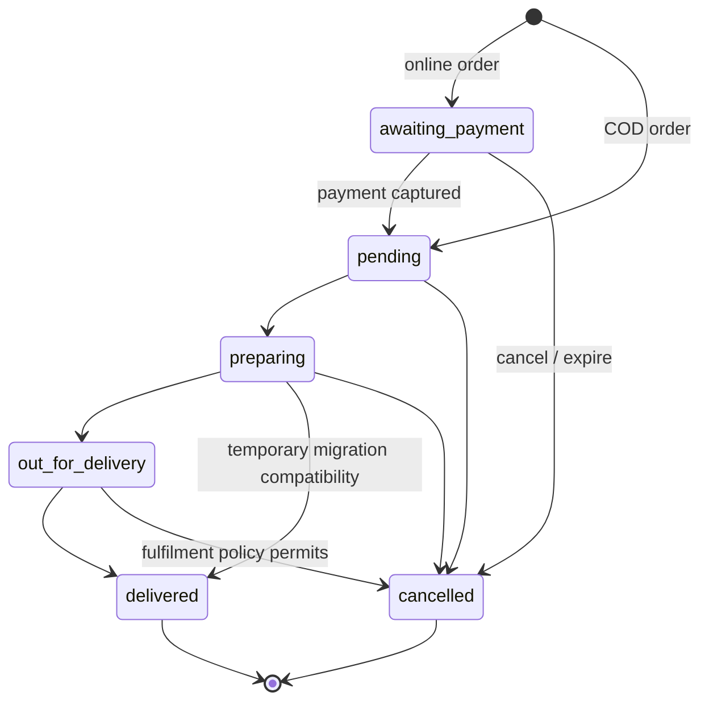
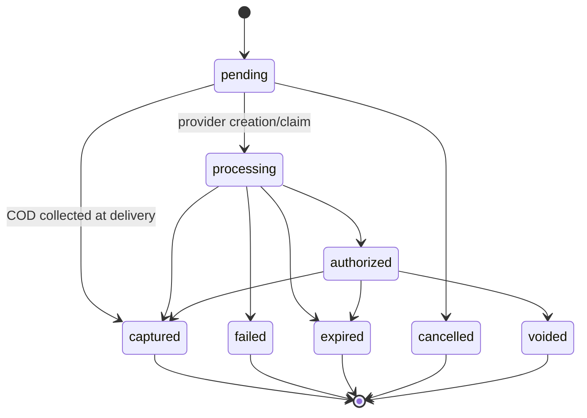
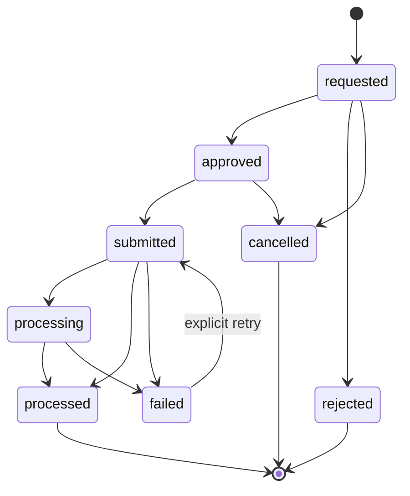
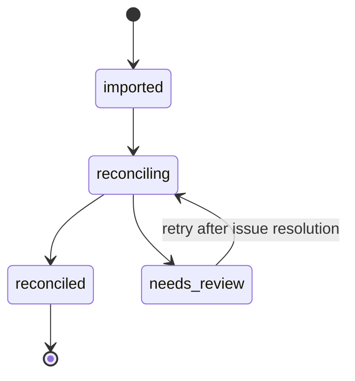
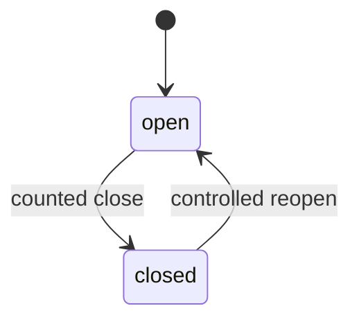
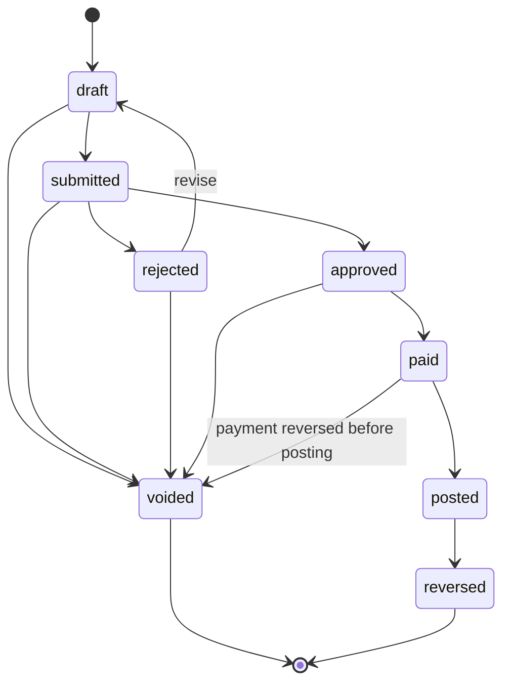
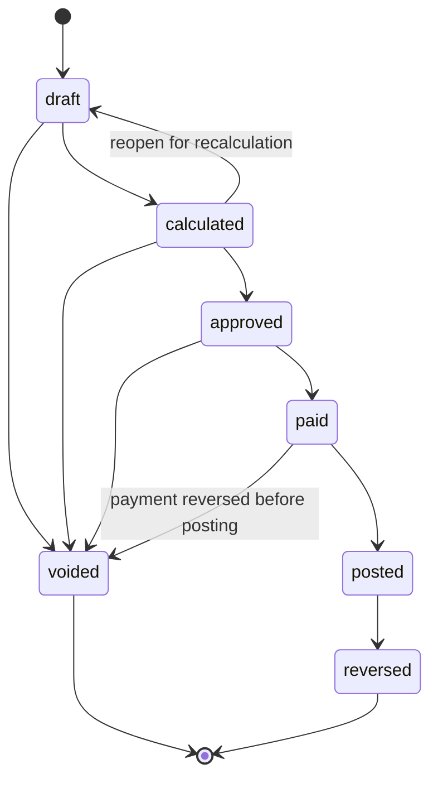
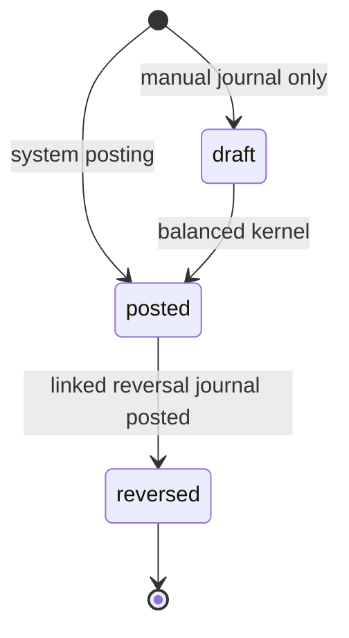

# Finance lifecycle and event contracts

- Status: Target contract accepted for phased implementation
- Date: 2026-08-31
- Related decisions: [ADR-001](adr/0001-money-representation-and-rounding.md), [ADR-002](adr/0002-revenue-cogs-recognition-and-refunds.md), [ADR-003](adr/0003-ledger-accounts-and-posting-rules.md), [ADR-004](adr/0004-tax-inclusive-demo-policy.md), [ADR-005](adr/0005-store-timezone-business-date-financial-year.md)

## Scope and current-reality boundary

This document defines target contracts for P1-P6. It does not claim they are implemented in P0.2.

Today, orders use `awaiting_payment`, `pending`, `preparing`, misspelled `delievered`, and `cancelled`; `preparing` goes directly to `delievered`. Payments are one-per-order with `pending`, `processing`, `completed`, `failed`, and `refunded`. Refund, settlement, cash-session, expense, pay-run, outbox, fiscal-period, and journal aggregates do not exist yet.

Later commits must use migrations and compatibility adapters described in `guide.md`; they must not make documentation true by pretending the planned schema already exists.

## State-machine rules

- A repeated command to the current state is a no-op only when its immutable identity and payload agree with the original command.
- Every other unlisted transition is rejected with a stable conflict error.
- Terminal financial history is corrected through reversal or a new aggregate, never by reopening or editing it unless a controlled transition is shown.
- Provider observations cannot skip local validation. Duplicate and out-of-order observations are retained but have at most one state/financial effect.
- State mutation, audit record, and required outbox events share one database transaction.

### Order

Only canonical `delivered` emits recognition. The legacy `delievered` spelling is accepted only during P1.9 migration, normalized on reads, and never written afterward. A post-delivery monetary correction uses a refund or recognition-reversal event; it does not change the order back to `cancelled`.

### Payment attempt

A retry after a terminal failure creates a new attempt under the same order. Refund state never overwrites a captured attempt; refunds are separate aggregates. Provider status remains a separate observation field from the normalized local status.

### Refund

Only verified provider/reconciliation evidence or an authorized COD cash action can enter `processed`. An explicit retry retains history and increments the source version. Processed allocations are immutable, and their sum equals the refund total.

### Settlement batch

An invalid file fails before a batch is accepted. A reconciled provider batch is immutable; later provider corrections arrive as a new adjustment/batch linked to the original. Reconciliation issues have their own open/resolved audit lifecycle and do not silently change source truth.

### Cash session

There is at most one open session per `(storeId, businessDate)`. Reopen requires owner/manager authority, recent authentication, reason, and audit. Closing or reopening never deletes movements; a changed count or correction is represented by new movement/reversal records.

### Expense

Approval and payment enforce actor-level segregation in addition to permissions. A posted expense is immutable; correction creates a reversal and, if required, a new expense.

### Pay run

Only draft data can be recalculated. Approval, payment, and posting require separate permissions and actor policies. Posted snapshots cannot be recalculated; correction is reversal plus a new run.

### Journal

`reversed` describes the original after one linked reversal posts. The reversal is itself a posted journal. Drafts have no reporting effect; posted lines are immutable.

## Financial event envelope

Every transactional outbox event uses this logical envelope:

| Field | Contract |
| --- | --- |
| `eventId` | Globally unique immutable event identifier |
| `eventType` | Stable dotted semantic name, for example `order.delivered` |
| `schemaVersion` | Positive integer payload schema version; the wire name is `eventType.vN` |
| `sourceType` / `sourceId` | Aggregate type and immutable identifier |
| `sourceVersion` | Positive monotonic aggregate mutation version; retries reuse it |
| `storeId` | Required store scope; no implicit current-store lookup |
| `currency` | `INR` for monetary events |
| `occurredAt` | Immutable UTC source-transition time |
| `businessDate` / `timezone` | Snapshots derived under ADR-005 |
| `actorId` | User/service actor when applicable; no sensitive actor data |
| `correlationId` / `causationId` | Trace across request, provider observation, and derived events |
| `payload` | Versioned immutable posting inputs; no secrets or full provider payload |

The idempotency key for journals is `(sourceType, sourceId, eventType, sourceVersion)`. `schemaVersion` describes payload shape and is not the same as `sourceVersion`. A schema upgrade changes the wire suffix; a retry does neither.

Consumers use snapshotted payload values and identifiers. They must not recalculate history from current catalogue prices, tax rules, costs, compensation, provider data, or browser input.

## Event catalogue and minimum payloads

All names below are version 1 wire names. Common envelope fields are omitted from the payload column.

| Event | Source | Minimum payload beyond envelope | Financial/reversal behavior |
| --- | --- | --- | --- |
| `payment_attempt.captured.v1` | Payment attempt | `paymentAttemptId`, `orderId`, `provider`, `method`, `capturedPaise`, `capturedAt`, immutable provider reference or COD session ID | Dr collection asset, Cr Customer Advances; never revenue. Correct by an explicit refund/charge reversal, not status edit. |
| `payment_attempt.failed.v1` | Payment attempt | `paymentAttemptId`, `orderId`, safe failure code, `failedAt` | Observation only; no journal. Retry creates a new attempt. |
| `order.delivered.v1` | Order | `orderId`, pricing policy version, customer total, pre-discount taxable food, discount contra component, taxable delivery, included item/delivery tax, rounding adjustment, line cost snapshots, `deliveredAt` | Recognizes revenue/tax/COGS once. Correct with `order.recognition_reversed` and any separate inventory return. |
| `order.recognition_reversed.v1` | Order | `orderId`, original recognition source key, explicit erroneous-fulfilment correction ID, reason, authorized actor, effective business date | Exact opposite of the referenced recognition journal; only evidence that delivery recognition itself was wrong can emit it. A monetary refund cannot. |
| `inventory.return_accepted.v1` | Inventory return | `returnId`, `orderId`, returned line IDs/quantities/cost snapshots, reason | Reverses only supported COGS allocations. A refund alone cannot emit it. |
| `refund.processed.v1` | Refund | `refundId`, `orderId`, `paymentAttemptId`, total, item/delivery/tax/discount allocations, provider/COD reference, `processedAt`, fulfilment state | Before delivery clears Customer Advances; after delivery posts contra revenue/tax to Refunds Payable. Never implies inventory return. Reverse only through a linked refund correction. |
| `refund.failed.v1` | Refund | `refundId`, `paymentAttemptId`, safe failure code, `failedAt` | Observation only; no journal. Explicit retry increments source version. |
| `refund.disbursed.v1` | Refund | `refundId`, `method`, disbursed total, clearing/cash reference, `disbursedAt` | Dr Refunds Payable, Cr Razorpay Clearing or Cash. Reverse from exact original lines if external evidence is corrected. |
| `settlement.reconciled.v1` | Settlement batch | `batchId`, provider settlement ID, gross, net, fee, fee tax, typed adjustments, UTR/reference, line match IDs, `settledAt` | Clears Razorpay Clearing to bank and explicit fee/adjustment accounts. A provider correction is a new linked batch, not mutation. |
| `cash.movement_recorded.v1` | Cash movement | `movementId`, `sessionId`, type, amount, order/refund/source reference, reason when manual | Manual cash-in/out, deposit, and adjustment types post through explicit mappings. COD/refund movements already represented by payment/refund events are evidence only and never post twice. Correction is an opposite linked movement. |
| `cash.session_closed.v1` | Cash session | `sessionId`, opening float, movement totals, expected, counted, variance, `closedAt` | Posts Cash Over/Short only for non-zero variance. Reopen emits a reversal event before new close. |
| `cash.session_reopened.v1` | Cash session | `sessionId`, prior close source key, reason, authorized actor, `reopenedAt` | Reverses the prior close-variance journal exactly; movements remain. |
| `expense.posted.v1` | Expense | `expenseId`, vendor/category IDs, exact allocations/account mappings, inclusive total, payment method/reference, paid/posted times | Dr explicit expense accounts, Cr Bank/Cash. Correction uses `expense.reversed`. |
| `expense.reversed.v1` | Expense | `expenseId`, original posting source key, reason, authorized actor, effective business date | Exact opposite of original journal; original source remains immutable. |
| `pay_run.posted.v1` | Pay run | `payRunId`, period, store/cost-center allocations, earning/net/deduction/employer-cost totals and account mappings, payment reference, posted time | Posts explicit payroll expense, payable/liability, and bank lines. Correction uses `pay_run.reversed`. |
| `pay_run.reversed.v1` | Pay run | `payRunId`, original posting source key, reason, authorized actor, effective business date | Exact opposite of original journal; sensitive employee detail stays outside event/log metadata. |

Manual journals enter the posting kernel as commands with a caller-supplied idempotency key, actor, reason, store, business date, and balanced lines. They do not masquerade as domain events.

## Reversal contract

1. A reversal command identifies exactly one posted source journal and supplies reason, authorized actor, correlation ID, and effective open business date.
2. The posting kernel copies the original lines and exchanges debit with credit. It never recalculates the original using current rules.
3. A unique original-journal reference permits at most one active reversal. Duplicate identical commands return the existing result; conflicting duplicates fail.
4. A correction that replaces business meaning is two operations: reverse the old journal, then post a new source/version. The two remain independently traceable.
5. Reversal does not mutate an operational aggregate unless that aggregate's state machine explicitly transitions to `reversed` or emits a corresponding correction event.
6. Closed-period history remains closed. The reversal posts in an authorized open period and preserves the original period reference.

## Global database lock order

The current repository already locks an order before its payment/inventory work and locks multiple store-product rows by ascending ID. Finance workflows extend that convention.

When one transaction must lock more than one existing row, acquire only the required classes in this order:

| Rank | Lock class |
| --- | --- |
| 1 | Store membership/configuration rows needed for transactional authorization, ordered by store then row ID |
| 2 | Settlement batch and settlement lines, ordered by batch then line ID |
| 3 | Cart |
| 4 | Order |
| 5 | Payment attempts, ascending ID |
| 6 | Refunds, ascending ID |
| 7 | Cash session, then cash movements ascending ID |
| 8 | Expense, then allocations ascending ID |
| 9 | Pay run, then employee/line rows ascending ID |
| 10 | Store-product rows, ascending ID |
| 11 | Inventory reservations, ascending ID |
| 12 | Coupon redemption, then coupon |
| 13 | Fiscal period |
| 14 | Existing journal entry when reversing; journal lines ascending ID |

Rules:

- Resolve IDs and authorize store scope before the write transaction where possible; high-risk operations re-authorize inside the transaction and lock membership first.
- A workflow reached from a child ID still resolves its parent IDs first, then starts a transaction and locks in the table above. For example, a refund action locks order, payment attempt, then refund.
- Lock multiple stores and multiple rows in ascending `(storeId, id)` order.
- Inserts into audit, outbox, movement, allocation, and journal-line tables do not require locking a nonexistent row; uniqueness constraints remain mandatory.
- Claim webhook-inbox or outbox work in a short transaction, commit the claim, then run the domain/posting transaction. Never hold a queue claim row while waiting on domain locks.
- Never hold a database transaction open across Razorpay, file storage, email, or any other network call. Persist intent, commit, perform the external call, then reconcile the result in a new transaction.
- Posting locks the applicable fiscal period before inserting a journal. Period close locks only the period/control rows and never walks backward into source aggregates.
- If a new workflow cannot obey this order, document and test a revised global order before implementation; do not add a local exception.
- Use PostgreSQL-backed concurrency tests for refund limits, cash close versus late COD, period close versus posting, event replay, and two posting workers. Mocks cannot prove lock behavior.

## Contract invariants

- Every accepted transition appears in exactly one diagram; every unlisted transition fails.
- One source mutation version emits at most one event of a given type and creates at most one journal.
- State mutation, audit, and required outbox writes commit or roll back together.
- Duplicate/out-of-order provider events have at most one financial effect and remain observable.
- Posted and processed records are corrected through linked reversal, never overwrite or deletion.
- Every reversal neutralizes its referenced journal exactly.
- Every posted journal balances in integer paise.
- Processed refunds never exceed captured or collected funds under concurrency.
- A refund does not create an inventory return or COGS reversal.
- `out_for_delivery`, failed payment, failed refund, and imported-but-unreconciled settlement states post nothing.
- All multi-row locks follow the global class order and ascending IDs within a class.
