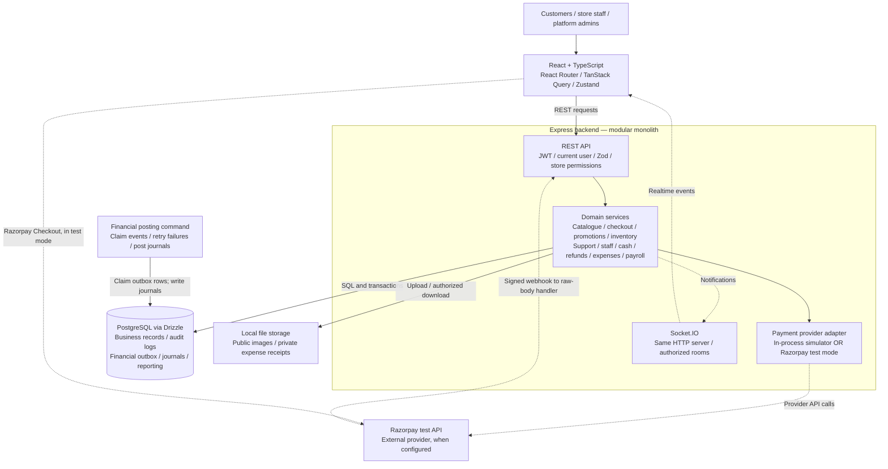
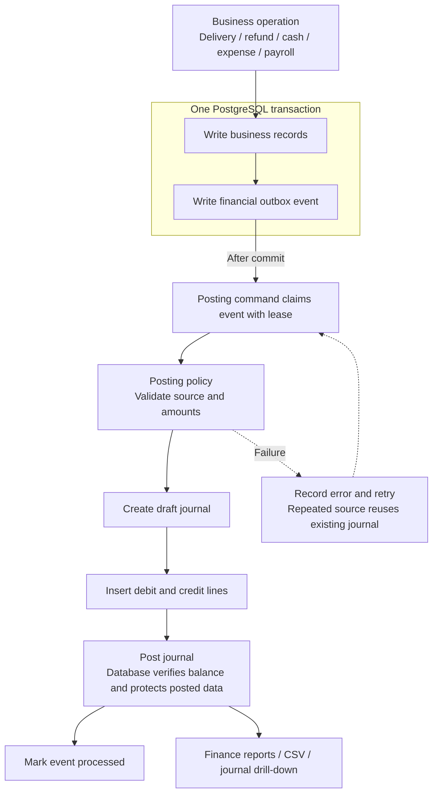

# PizzaStore — high-level design

The portfolio view is public at `/docs/architecture#high-level-design`. The storefront footer links to it through **Engineering case study**. Reviewed against the local source on 10 October 2026.

## System overview

One React application, one modular Express backend, and one PostgreSQL database. The financial posting command runs separately using the same backend code.

- Customers, store staff, and admins use the React application. React Router handles navigation, TanStack Query owns server data, and Zustand owns shared client state.
- Express authenticates the current user, validates input with Zod, and checks platform or store permissions. Domain services handle catalogue, checkout, promotions, inventory, support, and finance.
- Drizzle reads and writes PostgreSQL. Checkout stores authoritative prices and coordinates local order, payment, promotion, and stock changes within a transaction.
- Online payments use a configurable provider adapter: the credential-free simulator runs in the backend; Razorpay test mode calls an external provider and verifies signed webhooks.
- Financial events are saved in the same transaction as their business changes. A separately invoked posting command claims those events and creates balanced journals. Socket.IO supplies a separate channel for order, stock, and support notifications.
- Product and promotion images are served from public local uploads. Expense receipts live in private local storage and are downloaded through an authorized API route.

## Financial posting

The database outbox bridges business changes and accounting. Socket notifications do not drive financial posting.

- Order delivery, refunds, cash operations, expenses, and payroll write financial events alongside their business records in a local database transaction.
- The posting command claims supported events with a lease. A posting policy translates each event into debit and credit lines; source identities make repeated posting requests idempotent.
- The journal starts as a draft. Its lines are inserted before the status changes to posted. PostgreSQL triggers require a balanced journal and prevent changes to posted entries and lines.
- A successfully handled event is marked processed. Failed events record their error and become eligible for retry according to the outbox policy. If posting commits before acknowledgment, a retry reuses the existing journal.
- Reports read posted journal data. The HTTP server does not automatically run this batch command; an operator or external scheduler must invoke it.

## Design choices to discuss

- **Modular monolith:** local checkout changes can commit together; modules share a process and release boundary.
- **Server-owned pricing:** persisted order snapshots preserve selling prices, discounts, and demo tax after catalogue changes.
- **Store-level authorization:** platform roles and store memberships are checked on the server; UI visibility follows those permissions.
- **Payment adapter:** the simulator makes the portfolio usable without provider credentials; Razorpay test mode exercises an external boundary.
- **Transactional financial outbox:** business writes and their financial events commit together; posting is retriable and source identities prevent duplicate journals.
- **Immutable posted journals:** drafts receive their lines before posting; PostgreSQL triggers verify balance and protect posted records.
- **Separate realtime channel:** Socket.IO improves responsiveness; reconnecting clients still read authoritative state through the API.
- **Local file storage:** public food photos and private receipts have different access paths. A deployment with multiple API instances would need shared storage and a shared Socket.IO adapter.

## Diagram exports

The existing [SVG](architecture.svg) and [PNG](architecture.png) are presentation exports. The Markdown and website Mermaid sources are the maintainable descriptions; regenerate exports when their component boundaries change.

## Portfolio presentation

A diagram is useful supporting evidence, but it is not required to use the product. Link **Live demo**, **Architecture**, and **Source code** from the portfolio project card. Start a walkthrough with this overview, then show the checkout sequence, last-item inventory scenario, and financial posting. Keep implementation details on the public case-study pages so recruiters can choose their level of detail.

These views describe logical components rather than a particular hosting provider or deployment topology. The posting worker is a separately invoked batch command, not an automatic background loop in the HTTP server. Money is integer paise; configured tax rules and payment history are portfolio demonstration data.

The website diagram source lives in `frontend/src/features/docs/content/diagrams/architecture.ts`. Keep this Markdown view synchronized when those boundaries change.
