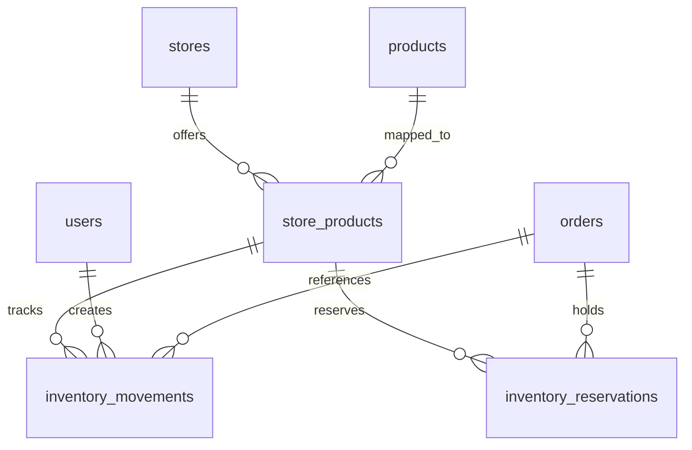

# Inventory & Stock Management — v2

Per-store inventory tracking with reservation lifecycle, append-only movement history, real-time low-stock alerts, and storefront scarcity indicators.

## Problem statement

PizzaStore currently tracks product availability as a simple boolean toggle (`store_products.is_available`). There is no concept of quantity — an admin manually flips a product to unavailable when it runs out, and there is no visibility into stock levels, no history of changes, and no automated safeguards against overselling.

For a multi-store food delivery platform, this creates three gaps:

1. **Overselling risk** — Two concurrent checkouts can both succeed for the last unit of a product because nothing enforces quantity limits inside the order transaction.
2. **Operational blindness** — Admins have no visibility into which products are running low. They react to stockouts instead of preventing them.
3. **Poor customer experience** — Customers discover a product is unavailable only after attempting to add it to cart. There are no scarcity signals.

## Design goals

- Inventory is tracked **per store-product pair**, extending the existing `store_products` junction table.
- Stock is decremented or reserved **atomically inside the existing order transaction** using `SELECT ... FOR UPDATE` to prevent overselling under concurrent checkouts.
- COD orders **decrement on-hand quantity immediately**. Razorpay orders **reserve stock** until payment is captured, failed, expired, or cancelled.
- Every stock change (sale, restock, adjustment, return) is recorded in an **append-only movement log** (application-enforced, not database-enforced immutability) with actor, reason, and resulting quantity.
- Manual availability (`is_available`) and stock-derived availability are **separate concerns** — never conflated.
- Admins receive **real-time Socket.IO notifications** when a product's stock drops below its configured threshold.
- The storefront shows **"Only X left" scarcity badges** and **greyed-out "Out of Stock" labels** — products remain visible but unorderable at 0.

## Scope boundary

### What this feature covers (product-level inventory)

- Base product quantity is tracked per store-product.
- Every purchased unit deducts one base-product unit, regardless of its selected customization options.
- Existing customization-option availability remains a boolean control.
- Customization options do not have independent quantities in this version.
- For made-to-order products (like pizzas), the quantity represents the number of units the store is currently willing or able to fulfil, not raw ingredient stock.

### What this feature does NOT cover

The system does not calculate pizza availability from cheese, dough, toppings, or other ingredient stock. Ingredient-based inventory would require ingredients, measurement units, per-size recipes, customization consumption rules, wastage, substitutions, and recipe-version history. It is a separate future feature.

```text
Phase 1/2: Product-level inventory
  Base product quantities, reservations, movements, alerts, and admin UX.

Future Phase 3: Ingredient and recipe inventory
  Ingredients, recipes, option-specific consumption, and derived product capacity.
```

---

## Data model

### Columns added to `store_products`

The existing `store_products` table gains three new columns. No new table is needed for the stock count itself — it lives alongside the price and availability flag it already manages.

| Column | Type | Default | Constraint | Notes |
| --- | --- | --- | --- | --- |
| `on_hand_quantity` | integer | `NULL` | `CHECK (on_hand_quantity IS NULL OR on_hand_quantity >= 0)` | Current physical stock level. `NULL` means unlimited (inventory tracking disabled). |
| `low_stock_threshold` | integer | `10` | `CHECK (low_stock_threshold >= 0)` | Stock level at or below which a low-stock alert is triggered |
| `last_restocked_at` | timestamptz | `NULL` | | Updated only on restock operations (not arbitrary positive adjustments). Can also be derived from the movement log — kept as a column for faster list queries. |

> [!IMPORTANT]
> The existing `is_available` column represents an **admin/product decision** (e.g., seasonal item, temporarily pulled). It is **never modified** by inventory logic. Stock availability is derived:
>
> ```text
> sellable = product.is_available
>         && store_product.is_available
>         && (on_hand_quantity IS NULL || available_quantity > 0)
>
> available_quantity = on_hand_quantity - active_reserved_quantity
> ```

This prevents bugs like:
- A product manually disabled for a seasonal reason being automatically re-enabled by a restock.
- No way to tell whether a product is unavailable because of stock or an admin action.

### New table: `inventory_reservations`

Durable per-order stock reservation for online payment flows. Prevents abandoned Razorpay attempts from consuming stock permanently.

| Column | Type | Constraints | Notes |
| --- | --- | --- | --- |
| `id` | integer | PK, generated always | |
| `order_id` | integer | FK → orders, NOT NULL | |
| `store_product_id` | integer | FK → store_products, NOT NULL | |
| `quantity` | integer | NOT NULL, `CHECK (quantity > 0)` | Positive integer |
| `status` | text | NOT NULL, default `"reserved"` | `"reserved"`, `"consumed"`, or `"released"` |
| `expires_at` | timestamptz | NOT NULL | Reservation expiry (e.g., 30 minutes from creation) |
| `consumed_at` | timestamptz | nullable | When reservation was converted to a sale |
| `released_at` | timestamptz | nullable | When reservation was released (failure/expiry/cancellation) |
| `created_at` | timestamptz | NOT NULL, default `now()` | |
| `updated_at` | timestamptz | NOT NULL, default `now()` | |

Unique constraint: `(order_id, store_product_id)` — prevents retries from reserving the same item twice.

Indexes:
- `(store_product_id, status)` — for computing active reserved quantity
- `(status, expires_at)` — for expiry reconciliation queries

### New table: `inventory_movements`

Append-only audit trail for every stock change. Rows are insert-only by application convention — never updated or deleted. (Database-level immutability via triggers is not enforced in this version; application enforcement plus tests is sufficient.)

| Column | Type | Constraints | Notes |
| --- | --- | --- | --- |
| `id` | integer | PK, generated always | |
| `store_product_id` | integer | FK → store_products, NOT NULL | Which store-product mapping was affected |
| `change_type` | text | NOT NULL, `CHECK (change_type IN ('sale', 'restock', 'adjustment', 'return', 'cancellation'))` | Movement type |
| `quantity_change` | integer | NOT NULL | Signed value: negative for deductions, positive for additions |
| `previous_quantity` | integer | NOT NULL | `on_hand_quantity` before this change |
| `new_quantity` | integer | NOT NULL, `CHECK (new_quantity = previous_quantity + quantity_change)` | `on_hand_quantity` after this change |
| `reason` | text | nullable (NOT NULL for `adjustment` type) | Human-readable explanation. Adjustments require a reason. |
| `order_id` | integer | FK → orders, nullable | Related order (for sales, returns, cancellations) |
| `idempotency_key` | text | UNIQUE, nullable | Prevents duplicate movements from repeated webhooks/retries. Format: `sale:{orderId}:{storeProductId}`, `return:{orderId}:{storeProductId}`, etc. |
| `created_by` | integer | FK → users (`ON DELETE SET NULL`), nullable | The admin who made the change. NULL = system (automated sale deduction). |
| `created_at` | timestamptz | NOT NULL, default `now()` | No `updated_at` — movements are append-only |

Indexes:
- `(store_product_id, created_at DESC)` — for stock history queries
- `(order_id, change_type)` — for finding movements related to a specific order

### Entity relationships



### Schema files

| File | Contents |
| --- | --- |
| `backend/src/db/schema/store.schema.ts` (MODIFY) | Add `onHandQuantity`, `lowStockThreshold`, `lastRestockedAt` to `storeProductsTable` |
| `backend/src/db/schema/inventory.schema.ts` (NEW) | `inventoryMovementsTable`, `inventoryReservationsTable` |

### What happens when a store-product mapping is removed

The application currently allows `store_products` rows to be deleted. Once movements and reservations reference that row, deletion would fail due to FK constraints.

Decision: **soft-remove** store-product mappings that have inventory history by setting `is_available = false`. Alternatively, add `ON DELETE SET NULL` on `store_product_id` in movements/reservations and snapshot `store_id` + `product_id` in the movement record. For v1, prefer soft-removal — it is simpler and preserves referential integrity.

---

## Inventory lifecycle

### COD orders — immediate deduction

```text
buildQuote() transaction:
  1. Lock cart row (existing)
  2. Validate cart, store, address, delivery zone (existing)
  3. assertProductsAvailable() (existing)
  4. ★ aggregateAndValidateStock()
     - Sum all cart-line quantities by productId (handles same product with different customizations)
     - Lock store_product rows FOR UPDATE in ascending store_products.id order (deterministic → avoids deadlocks)
     - Compute available = on_hand - active_reserved for each product
     - Reject if any product has insufficient available quantity
  5. Calculate subtotal, validate coupon, compute discount (existing)
  6. Return quote with validated stock info

createOrder() transaction (wrapping buildQuote):
  7. Create payment, create order snapshot (existing)
  8. ★ decrementStock()
     - Decrement on_hand_quantity for each product
     - Insert inventory_movement with change_type = "sale", idempotency_key = "sale:{orderId}:{storeProductId}"
  9. Handle coupon, clear cart (existing)
  10. Return order + low-stock alerts
```

### Razorpay orders — reserve → consume/release

```text
findOrCreateLocalAttempt() transaction (in payment.service.ts):
  1. buildQuote() — includes stock validation (step 4 above)
  2. Create payment, create order snapshot with status "awaiting_payment" (existing)
  3. ★ reserveStock()
     - Create inventory_reservation rows with status = "reserved", expires_at = now + 30min
     - Do NOT decrement on_hand_quantity yet
  4. Handle coupon reservation, clear cart (existing)

finalizeCapturedPayment() transaction (in payment.service.ts):
  5. Lock order + payment (existing)
  6. ★ consumeReservations()
     - Lock reservation rows FOR UPDATE
     - Verify all reservations are still "reserved" (not expired/released)
     - Set status = "consumed", consumed_at = now
     - Decrement on_hand_quantity for each store_product
     - Insert inventory_movement with change_type = "sale"
  7. Update payment status, order status → "pending" (existing)
  8. Consume coupon reservation (existing)

markProviderPaymentFailed() transaction (in payment.service.ts):
  9. Lock order + payment (existing)
  10. ★ releaseReservations()
      - Lock reservation rows FOR UPDATE
      - Set status = "released", released_at = now (idempotent — skip if already released/consumed)
  11. Release coupon reservation (existing)

Reservation expiry (reconciliation job or on next stock query):
  12. Find reservations where status = "reserved" AND expires_at < now
  13. Release each one idempotently (same as step 10)
```

### Order cancellation — stock restoration

The application already supports the `cancelled` order status. Once stock deduction exists, cancellation without restoration makes inventory inaccurate.

```text
updateOrderStatus() — when new status is "cancelled":
  1. Lock order row
  2. Verify order was in a cancellable state
  3. ★ restoreStock()
     - Find movements with change_type = "sale" for this order
     - For each: increment on_hand_quantity, insert movement with change_type = "cancellation"
     - Use idempotency_key = "cancellation:{orderId}:{storeProductId}" to prevent double restoration
  4. If order had reservations instead of deductions (abandoned Razorpay), release reservations
  5. Release coupon if applicable
```

> [!IMPORTANT]
> Restoration must be idempotent. Repeated cancellation requests, payment webhooks, or reconciliation jobs must not add stock twice. The `idempotency_key` unique constraint on `inventory_movements` enforces this.

### Available quantity computation

```text
available = on_hand_quantity - SUM(reservation.quantity WHERE status = 'reserved')
```

This is computed on read — no denormalized column. For the admin inventory list and storefront stock status, a single query joins `store_products` with an aggregated subquery on `inventory_reservations`.

---

## API endpoints

All inventory-specific endpoints are admin-only (`authenticateAdmin` middleware).

### Inventory management

| Method | Path | Description |
| --- | --- | --- |
| `GET` | `/api/v1/inventory/store/:storeId` | Paginated list of store products with stock levels. Query params: `status` (all/low_stock/out_of_stock), `search`, `page`, `limit` |
| `GET` | `/api/v1/inventory/store/:storeId/product/:productId` | Single product stock details with recent movement entries |
| `POST` | `/api/v1/inventory/store/:storeId/product/:productId/restock` | Restock a product. Body: `{ quantityAdded, reason? }` |
| `POST` | `/api/v1/inventory/store/:storeId/product/:productId/adjustment` | Set stock to an absolute value. Body: `{ targetQuantity, reason }` (reason required) |
| `POST` | `/api/v1/inventory/store/:storeId/bulk-restock` | Bulk restock. Body: `{ items: [{ productId, quantityAdded, reason? }] }`. Max 50 items. |
| `GET` | `/api/v1/inventory/store/:storeId/movements` | Paginated movement log. Query params: `changeType`, `from`, `to`, `page`, `limit` |
| `PATCH` | `/api/v1/inventory/store/:storeId/product/:productId/threshold` | Update low-stock threshold. Body: `{ threshold }` |

### Storefront (user-facing)

No new endpoints are added. Existing product listing queries **change their filtering and response shape**:

- Queries must return manually available products even when their derived stock status is `out_of_stock` (they appear greyed out, not hidden).
- The `is_available` filter in storefront queries must **not** be used as a proxy for stock availability.

Response fields added to product listings:

| Field | Type | Notes |
| --- | --- | --- |
| `stockStatus` | `"untracked"` \| `"in_stock"` \| `"low_stock"` \| `"out_of_stock"` | `"untracked"` when `on_hand_quantity IS NULL` |
| `stockCount` | integer \| null | Present only when `stockStatus === "low_stock"`. Exact counts are not exposed for in-stock products. |

Stock status derivation:

```text
if on_hand_quantity IS NULL → "untracked"
if available_quantity <= 0  → "out_of_stock"
if available_quantity <= low_stock_threshold → "low_stock" (expose count)
else → "in_stock"
```

> [!NOTE]
> Zero is represented as `out_of_stock`, never `low_stock`. A product at exactly the threshold value is `low_stock`.

### Structured error responses

For insufficient-stock errors during cart mutation or checkout, return structured error codes instead of English messages:

```json
{
  "error": {
    "code": "INSUFFICIENT_STOCK",
    "message": "Insufficient stock for one or more items",
    "items": [
      {
        "productId": 7,
        "productName": "Margherita Pizza",
        "requestedQuantity": 3,
        "availableQuantity": 1
      }
    ]
  }
}
```

### Request/response shapes

#### `POST /inventory/store/:storeId/product/:productId/restock`

```json
// Request
{
  "quantityAdded": 50,
  "reason": "Weekly restock from supplier"
}

// Response
{
  "data": {
    "storeProductId": 12,
    "productName": "Margherita Pizza",
    "previousQuantity": 3,
    "newQuantity": 53,
    "changeType": "restock"
  }
}
```

#### `POST /inventory/store/:storeId/product/:productId/adjustment`

```json
// Request — reason is required
{
  "targetQuantity": 20,
  "reason": "Physical count correction — damaged goods removed"
}

// Response
{
  "data": {
    "storeProductId": 12,
    "productName": "Margherita Pizza",
    "previousQuantity": 53,
    "newQuantity": 20,
    "quantityChange": -33,
    "changeType": "adjustment"
  }
}
```

#### `POST /inventory/store/:storeId/bulk-restock`

```json
// Request — max 50 items
{
  "items": [
    { "productId": 1, "quantityAdded": 50, "reason": "Weekly restock" },
    { "productId": 2, "quantityAdded": 30 },
    { "productId": 5, "quantityAdded": 100, "reason": "New supplier batch" }
  ]
}

// Response
{
  "data": {
    "restocked": 3,
    "items": [
      { "productId": 1, "productName": "Margherita", "previousQuantity": 3, "newQuantity": 53 },
      { "productId": 2, "productName": "Pepperoni", "previousQuantity": 0, "newQuantity": 30 },
      { "productId": 5, "productName": "Garlic Bread", "previousQuantity": 12, "newQuantity": 112 }
    ]
  }
}
```

---

## Backend service layer

### New feature module: `backend/src/features/inventory/`

| File | Responsibility |
| --- | --- |
| `inventory.routes.ts` | Admin-gated REST endpoints, Zod validation, Socket.IO emission |
| `inventory.service.ts` | Stock queries, restock/adjustment logic, movement writes, reservation lifecycle, threshold checks |

### Cart demand aggregation

The same product can appear in multiple cart lines with different customizations. All cart-line quantities must be aggregated by `productId` before stock validation.

```typescript
// Aggregate cart demand by product
const demandByProduct = new Map<number, number>();
for (const item of cart.items) {
  const current = demandByProduct.get(item.productId) ?? 0;
  demandByProduct.set(item.productId, current + item.quantity);
}

// Lock rows in deterministic order (ascending store_products.id)
const storeProducts = await tx
  .select()
  .from(storeProductsTable)
  .where(
    and(
      eq(storeProductsTable.storeId, cart.storeId),
      inArray(storeProductsTable.productId, [...demandByProduct.keys()])
    )
  )
  .orderBy(asc(storeProductsTable.id))
  .for("update");
```

**Why deterministic lock order?** If transaction A locks products [5, 3] and transaction B locks [3, 5], they can deadlock. Sorting by `store_products.id` ascending ensures all transactions acquire locks in the same order.

### Stock deduction — COD (pseudocode)

```typescript
async decrementStockForCod(
  demandByProduct: Map<number, number>,
  lockedStoreProducts: StoreProduct[],
  orderId: number,
  tx: TransactionType
): Promise<LowStockAlert[]> {
  const alerts: LowStockAlert[] = [];

  for (const sp of lockedStoreProducts) {
    if (sp.onHandQuantity === null) continue; // Untracked — skip

    const demanded = demandByProduct.get(sp.productId)!;
    const reserved = await this.getActiveReservedQuantity(sp.id, tx);
    const available = sp.onHandQuantity - reserved;

    if (available < demanded) {
      throw new AppError("Insufficient stock", 409, "INSUFFICIENT_STOCK", {
        items: [{ productId: sp.productId, requestedQuantity: demanded, availableQuantity: available }]
      });
    }

    const newQuantity = sp.onHandQuantity - demanded;
    const wasAboveThreshold = sp.onHandQuantity > sp.lowStockThreshold;

    await tx.update(storeProductsTable)
      .set({ onHandQuantity: newQuantity })
      .where(eq(storeProductsTable.id, sp.id));

    await tx.insert(inventoryMovementsTable).values({
      storeProductId: sp.id,
      changeType: "sale",
      quantityChange: -demanded,
      previousQuantity: sp.onHandQuantity,
      newQuantity,
      orderId,
      idempotencyKey: `sale:${orderId}:${sp.id}`,
    });

    if (wasAboveThreshold && newQuantity <= sp.lowStockThreshold) {
      alerts.push({ storeProductId: sp.id, productId: sp.productId, currentQuantity: newQuantity, threshold: sp.lowStockThreshold });
    }
  }

  return alerts;
}
```

### Stock reservation — Razorpay (pseudocode)

```typescript
async reserveStockForOnlinePayment(
  demandByProduct: Map<number, number>,
  lockedStoreProducts: StoreProduct[],
  orderId: number,
  tx: TransactionType
): Promise<void> {
  const expiresAt = new Date(Date.now() + 30 * 60_000); // 30 minutes

  for (const sp of lockedStoreProducts) {
    if (sp.onHandQuantity === null) continue; // Untracked — skip

    const demanded = demandByProduct.get(sp.productId)!;
    const reserved = await this.getActiveReservedQuantity(sp.id, tx);
    const available = sp.onHandQuantity - reserved;

    if (available < demanded) {
      throw new AppError("Insufficient stock", 409, "INSUFFICIENT_STOCK", { ... });
    }

    // Create reservation — unique (order_id, store_product_id) prevents double reservation
    await tx.insert(inventoryReservationsTable).values({
      orderId,
      storeProductId: sp.id,
      quantity: demanded,
      status: "reserved",
      expiresAt,
    });
  }
  // on_hand_quantity is NOT decremented — only reserved
}
```

### Reservation consumption — on payment capture

```typescript
async consumeReservations(orderId: number, tx: TransactionType): Promise<LowStockAlert[]> {
  const reservations = await tx
    .select()
    .from(inventoryReservationsTable)
    .where(
      and(
        eq(inventoryReservationsTable.orderId, orderId),
        eq(inventoryReservationsTable.status, "reserved")
      )
    )
    .orderBy(asc(inventoryReservationsTable.storeProductId))
    .for("update");

  const alerts: LowStockAlert[] = [];

  for (const reservation of reservations) {
    // Lock the store_product row
    const [sp] = await tx.select().from(storeProductsTable)
      .where(eq(storeProductsTable.id, reservation.storeProductId))
      .for("update");

    const newQuantity = sp.onHandQuantity! - reservation.quantity;

    // Consume reservation
    await tx.update(inventoryReservationsTable)
      .set({ status: "consumed", consumedAt: new Date() })
      .where(eq(inventoryReservationsTable.id, reservation.id));

    // Decrement on-hand
    await tx.update(storeProductsTable)
      .set({ onHandQuantity: newQuantity })
      .where(eq(storeProductsTable.id, sp.id));

    // Record movement (idempotent via unique key)
    await tx.insert(inventoryMovementsTable).values({
      storeProductId: sp.id,
      changeType: "sale",
      quantityChange: -reservation.quantity,
      previousQuantity: sp.onHandQuantity!,
      newQuantity,
      orderId,
      idempotencyKey: `sale:${orderId}:${sp.id}`,
    }).onConflictDoNothing(); // Idempotent — webhook/verify retries

    // Check threshold crossing
    if (sp.onHandQuantity! > sp.lowStockThreshold && newQuantity <= sp.lowStockThreshold) {
      alerts.push({ ... });
    }
  }

  return alerts;
}
```

### Reservation release — on failure/expiry

```typescript
async releaseReservations(orderId: number, tx: TransactionType): Promise<void> {
  // Idempotent — only releases "reserved" rows, skips "consumed" or already "released"
  await tx.update(inventoryReservationsTable)
    .set({ status: "released", releasedAt: new Date() })
    .where(
      and(
        eq(inventoryReservationsTable.orderId, orderId),
        eq(inventoryReservationsTable.status, "reserved")
      )
    );
}
```

### Integration points in existing code

| Existing file | Change |
| --- | --- |
| `checkout.service.ts` → `buildQuote()` | After `assertProductsAvailable()`: call `aggregateAndValidateStock()` to lock rows and validate available quantities |
| `order.service.ts` → `createOrder()` | After order snapshot: call `decrementStockForCod()` |
| `payment.service.ts` → `findOrCreateLocalAttempt()` | After order snapshot: call `reserveStockForOnlinePayment()` |
| `payment.service.ts` → `finalizeCapturedPayment()` | After payment status update: call `consumeReservations()` |
| `payment.service.ts` → `markProviderPaymentFailed()` | After coupon release: call `releaseReservations()` |
| `payment.service.ts` → `markProviderCreationFailed()` | After coupon release: call `releaseReservations()` |
| `order.service.ts` → `updateOrderStatus()` | When status changes to `cancelled`: call `restoreStock()` or `releaseReservations()` |

---

## Real-time notifications

### Socket.IO event: `lowStock`

| Event | Direction | Payload | Trigger |
| --- | --- | --- | --- |
| `lowStock` | Server → Admin clients | `{ storeId, storeName, productId, productName, currentQuantity, threshold, severity }` | Stock drops to or below `low_stock_threshold` |

`severity`: `"low_stock"` when quantity is above 0 but at or below threshold. `"out_of_stock"` when quantity reaches 0.

Rules:
- Emit **only after the database transaction commits** (in the route handler, not inside the service).
- Emit to admin room (or authorized store rooms if store-scoped admins are added later), not globally.
- A restock from 0 to a value still below the threshold should **not** trigger another low-stock alert. Alerts fire only when the threshold is **crossed downward**.
- A rolled-back transaction emits no alerts.
- Socket.IO is delivery assistance, not a durable notification system. The inventory page and database remain the source of truth.

---

## Frontend changes (Phase 2)

### Admin panel

#### New page: Inventory Management (`/admin/inventory`)

| Section | Description |
| --- | --- |
| **Store selector** | Dropdown (reuses existing `getStoresSelect` endpoint) |
| **Stock overview table** | TanStack Table: Product Name, On-Hand, Available (on-hand - reserved), Threshold, Status badge, Last Restocked. Paginated. |
| **Filters** | Status (All / Low Stock / Out of Stock), product name search |
| **Bulk restock** | Multi-select rows → "Restock Selected" → modal with quantity inputs per product. Max 50 items. |
| **Row actions** | Restock (modal), adjust stock (modal with required reason), edit threshold, view history |

#### Stock history drawer

Paginated list of `inventory_movements` entries per product:
- Timestamp, change type (color-coded badge), quantity change (`+50` / `-2`), resulting quantity, reason, actor name
- Filterable by change type

#### Dashboard widget (Phase 2)

Low Stock Items card — count of products where `available_quantity <= low_stock_threshold`. Clicking navigates to `/admin/inventory?status=low_stock`.

### Storefront

#### Product cards

- **`"untracked"`** / **`"in_stock"`** — No change to current behavior
- **`"low_stock"`** — Badge: "Only X left" in amber/orange
- **`"out_of_stock"`** — Grey out the card, overlay "Out of Stock" label, disable "Add to Cart"

#### Cart/checkout validation

The new stock check provides a structured error instead of a generic "Unavailable" message. The frontend can display per-item stock information.

---

## File change summary

### Backend

| Action | File | Change |
| --- | --- | --- |
| MODIFY | `src/db/schema/store.schema.ts` | Add `onHandQuantity`, `lowStockThreshold`, `lastRestockedAt` columns with CHECK constraints |
| NEW | `src/db/schema/inventory.schema.ts` | `inventoryMovementsTable`, `inventoryReservationsTable` with constraints and indexes |
| MODIFY | `src/db/schema/index.ts` | Re-export `inventory.schema.ts` |
| MODIFY | `src/db/schema/_relations.ts` | Add relations for new tables |
| NEW | `src/features/inventory/inventory.service.ts` | Stock validation, deduction, reservation lifecycle, movement writes, restock/adjustment |
| NEW | `src/features/inventory/inventory.routes.ts` | Admin REST endpoints with Zod validation |
| MODIFY | `src/features/checkout/checkout.service.ts` | Add `aggregateAndValidateStock()` in `buildQuote()` |
| MODIFY | `src/features/order/order.service.ts` | Call `decrementStockForCod()` in COD flow, `restoreStock()` on cancellation |
| MODIFY | `src/features/order/order.routes.ts` | Emit `lowStock` Socket.IO event after commit |
| MODIFY | `src/features/payments/payment.service.ts` | Call `reserveStockForOnlinePayment()` in initiation, `consumeReservations()` on capture, `releaseReservations()` on failure |
| MODIFY | `src/features/stores/stores.service.ts` | Include stock fields in store product queries, change storefront filtering |
| MODIFY | `src/features/dashboard/dashboard.service.ts` | Add `getLowStockCount()` (Phase 2) |
| MODIFY | `src/routes.ts` | Mount inventory routes |
| MODIFY | `src/utils/types.ts` | Add `InventoryChangeType`, `StockStatus`, `InventoryReservationStatus` types |

### Frontend (Phase 2)

| Action | File | Change |
| --- | --- | --- |
| NEW | `src/features/inventory/` | New feature module: pages, components, hooks |
| MODIFY | `src/features/admin-navigation/` | Add "Inventory" sidebar link |
| MODIFY | `src/features/admin-dashboard/` | Add low-stock count card |
| MODIFY | `src/features/catalog/` | Show stock badges, handle out-of-stock display |
| MODIFY | `src/features/cart/` | Handle structured `INSUFFICIENT_STOCK` errors |
| MODIFY | `src/app/routes.tsx` | Add `/admin/inventory` route |

### Database migration

One migration generated by `drizzle-kit`:
- ALTER `store_products`: add `on_hand_quantity` (with CHECK), `low_stock_threshold` (with CHECK), `last_restocked_at`
- CREATE TABLE `inventory_reservations` with unique constraint and indexes
- CREATE TABLE `inventory_movements` with CHECK constraints, unique `idempotency_key`, and indexes

---

## Phased rollout

### Phase 1: Inventory correctness

- Schema, constraints, indexes, and migrations
- Inventory service: stock validation, deduction (COD), reservation lifecycle (Razorpay), cancellation restoration
- Admin inventory list and single-item restock/adjustment
- Append-only movement history with idempotency
- Storefront stock status derivation and cart/checkout validation
- Structured error responses
- Concurrency and idempotency integration tests
- Structured logging for stock conflicts, reservation expiry, restoration, and duplicate callbacks

### Phase 2: Operations UX

- Bulk restock (multi-select form, max 50 items)
- Low-stock Socket.IO notifications
- Movement history drawer with filters
- Dashboard low-stock metric card
- Reservation expiry reconciliation job
- Search and reporting

---

## Acceptance tests

These tests must use **real PostgreSQL** integration tests for locking and concurrency behavior. Unit tests with mocked repositories cannot prove that `SELECT ... FOR UPDATE` prevents overselling.

| # | Test | What it proves |
| --- | --- | --- |
| 1 | Two separate database transactions attempt to buy the final unit; exactly one succeeds | `FOR UPDATE` serialization works |
| 2 | Multiple customized cart lines for the same product are aggregated before validation | Demand aggregation by `productId` |
| 3 | A transaction that fails after stock validation leaves stock and movements unchanged | Transaction rollback integrity |
| 4 | An untracked product (`on_hand_quantity = NULL`) behaves exactly as it does today | Backward compatibility |
| 5 | A manually disabled product stays disabled after restocking | Manual availability is separate from stock |
| 6 | A Razorpay retry does not create a second reservation | `(order_id, store_product_id)` unique constraint |
| 7 | A captured-payment webhook processed twice deducts stock once | `idempotency_key` on movements |
| 8 | A failed or expired payment releases its reservation once | Idempotent release (skip if not "reserved") |
| 9 | Cancelling an order restores stock once, even if the request is repeated | `idempotency_key` = `cancellation:{orderId}:{storeProductId}` |
| 10 | Restock and checkout against the same product serialize without a lost update | `FOR UPDATE` on concurrent operations |
| 11 | Bulk restock rolls back completely when any item is invalid | Transaction atomicity |
| 12 | Out-of-stock products remain visible in storefront but cannot be added to cart | Filtering change + cart validation |
| 13 | Crossing a threshold emits one alert only after commit; a rolled-back transaction emits none | Alert timing and correctness |

---

## Concurrency and edge cases

| Scenario | Handling |
| --- | --- |
| Two users checkout the last pizza simultaneously | `SELECT ... FOR UPDATE` on `store_products` in deterministic order serializes access. Second transaction fails with `INSUFFICIENT_STOCK`. |
| Same product appears in multiple cart lines (different customizations) | Quantities are aggregated by `productId` before validation. 3 Margherita lines of quantity 1 = demand of 3. |
| Admin restocks while a checkout is in progress | Both operations use `FOR UPDATE`. Serialized — no lost updates. |
| Stock is NULL (inventory not tracked) | All stock checks are skipped. Behavior is identical to current system. Allows gradual rollout. |
| Razorpay payment abandoned (user closes browser) | Reservation expires after 30 minutes. Reconciliation job or next stock query releases it. |
| Razorpay webhook arrives twice for the same capture | `idempotency_key` on movement prevents duplicate deduction. `consumeReservations()` skips already-consumed reservations. |
| Order cancelled after COD stock deduction | `restoreStock()` increments on-hand with `idempotency_key` = `cancellation:{orderId}:{spId}`. |
| Order cancelled that had Razorpay reservation (never paid) | `releaseReservations()` releases reserved rows, skips non-reserved. |
| Manually disabled product gets restocked | `is_available` stays `false`. Product remains hidden from storefront. Admin must re-enable manually. |
| Bulk restock with invalid product ID | Entire transaction rolls back. No partial restock. |
| `store_products` row deleted after having inventory history | Soft-removal preferred. FK constraints prevent hard delete. |

---

## Why this feature matters for portfolio

| Competency | How it's demonstrated |
| --- | --- |
| **Transactional integrity** | `SELECT ... FOR UPDATE` with deterministic lock ordering prevents overselling and deadlocks |
| **Reservation lifecycle** | Reserve/consume/release pattern mirrors how payment systems handle two-phase operations |
| **Idempotency** | Unique idempotency keys prevent duplicate stock movements from retried webhooks, reconciliation, or repeated user actions |
| **System design** | Append-only movement log, separation of manual/stock availability, structured error codes |
| **Real-time architecture** | Extending existing Socket.IO infrastructure for operational alerts with threshold-crossing logic |
| **Data modeling** | Nullable `on_hand_quantity` for backward compatibility, CHECK constraints, and computed `available_quantity` |
| **End-to-end ownership** | Single feature touching schema → service → routes → real-time → admin UI → storefront UX |
| **Operational thinking** | Low-stock thresholds, bulk restock, audit trails, expiry reconciliation — tooling that real businesses need |
